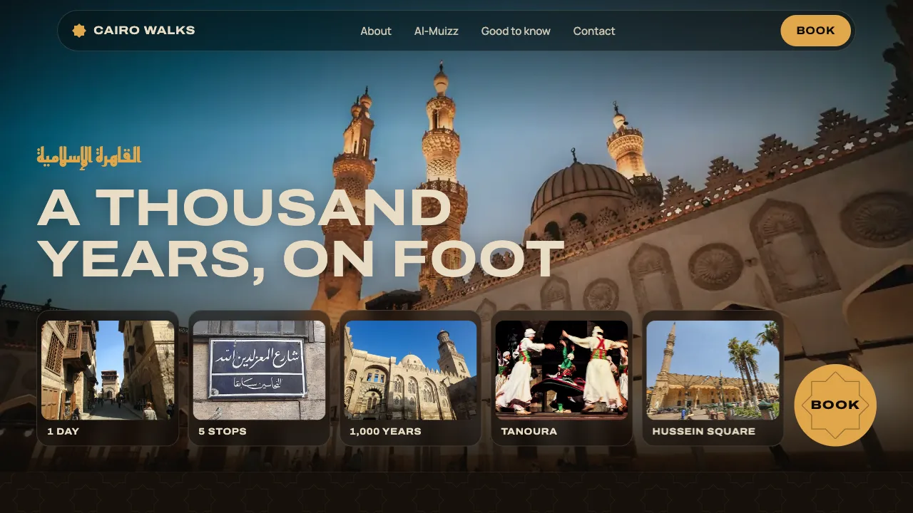
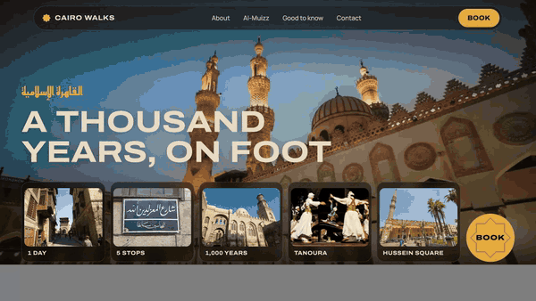

# Cairo Walks: a thousand years, on foot

Scroll-driven landing page for a one-day walking route through historic (Islamic) Cairo: Al-Ghouriya, Al-Azhar, Al-Hussein, Souq al-Sagha and Al-Muizz Street.

**Live:** https://khali70.github.io/islamic-cairo/





## What is on the page

- **Hero:** a slow-pan video of the route that settles into a framed inset, with the giant CAIRO word drifting away.
- **The walk, stop by stop:** a route line draws as you scroll, each stop in a pointed-arch photo frame with its Arabic name in Kufic type.
- **Al-Muizz Street:** a pinned horizontal gallery of eight monuments in walking order, from Bab Zuweila to Bab al-Futuh.
- **Good to know:** expanding cards for the Tanoura show, El Fishawy cafe, the night walk and mosque manners.
- **Booking:** an arch doorway opens onto Al-Azhar at night behind a glass request form.

Era styling throughout: Fatimid and Mamluk pointed arches, crenellation bands taken from the Al-Azhar roofline, and 8-point khatam stars.

## Performance

Measured with Lighthouse 12 (median of 3 runs):

| Run | Performance | LCP | CLS |
| --- | --- | --- | --- |
| Mobile | 100 | 1.6 s | 0.002 |
| Desktop | 100 | 0.5 s | 0.019 |
| Slow 3G | - | 3.8 s | 0.002 |

How it stays fast: the hero still is the video's own first frame and the LCP element; the video loads only after `load`, on a fast enough link and with Save-Data off. Phones get a still, no pinned scenes, and native swipe for the gallery. Reduced-motion users get a fully static page, and the page still works if the CDN or JavaScript fails.

## Stack

Static HTML and CSS, [GSAP 3.15](https://gsap.com/) (ScrollTrigger, SplitText) and [Lenis 1.3](https://lenis.darkroom.engineering/) smooth scroll. No build step.

## Run locally

```bash
npx serve .
```

Design notes, scene table and palette: [DESIGN.md](DESIGN.md). Photo credits: [images/CREDITS.md](images/CREDITS.md).
